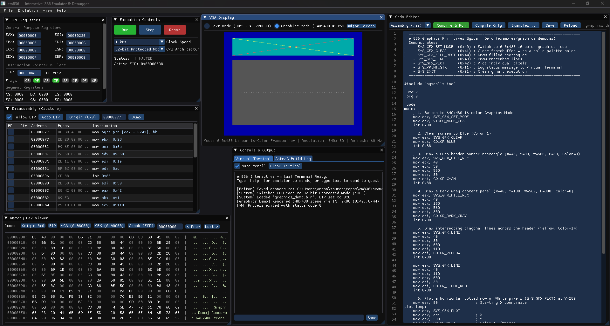

# em836 — Interactive i386 Emulator, Debugger & AstraC IDE

**em836** is a multi-threaded interactive x86 (i386 32-bit Protected Mode & i286 16-bit Real Mode) virtual machine, visual debugger, and integrated development environment built for bare-metal assembly and [**AstraC**](https://antonako.net/astrac/index.php) systems programming.

---

## Core Architecture

- **CPU Emulation ([Unicorn Engine](https://www.unicorn-engine.org/))**: Full x86 instruction execution running on a dedicated asynchronous worker thread with cycle-quantum throttling (`10 Hz` to `1 MHz` and `Unlimited`) and automatic QEMU TCG JIT cache invalidation (`uc_ctl_flush_tb` / `uc_ctl_flush_tlb`) for instant hot-reloading.
- **Real-Time Disassembly ([Capstone Engine](https://www.capstone-engine.org/))**: Live Intel-syntax instruction decoding with opcode byte inspection, `EIP` tracking (`=>`), and interactive breakpoints.
- **GPU-Accelerated Docking UI ([SDL3](https://libsdl.org/) + [Dear ImGui](https://github.com/ocornut/imgui))**: 60 FPS hardware-rendered workspace with 7 dockable debugger windows and in-place code editing.
- **Dual-Mode VGA Display**:
  - **Mode 0 (Text Mode @ `0x000B8000`)**: 80×25 character/attribute grid rendered with an embedded 8×16 IBM CP437 bitmap font.
  - **Mode 1 (Graphics Mode @ `0x000A0000`)**: 640×480 16-color linear framebuffer with software-accelerated drawing primitives (`PlotPixel`, Bresenham `DrawLine`, `FillRect`, `ClearScreen`).
- **Unified `INT 0x88` Syscall ABI**: Deterministic register-based system call dispatcher for Process Control, Console I/O, Host File I/O, Dynamic Heap Management (`SYS_SBRK`), and Accelerated 2D Graphics, plus legacy compatibility for `INT 0x10` (BIOS), `INT 0x21` (DOS), `INT 0x80` (Linux), and I/O ports `0x03F8` (COM1) / `0x00E9` (Bochs).
- **[AstraC Toolchain](https://antonako.net/astrac/index.php) Integration**: One-click assembly of `.as` files and compilation of `.ac` (Astra C) files directly into guest RAM, supporting raw flat binaries (`.bin`), 112-byte `ACFH` executables (`.exe`), and dynamic libraries (`.lib`) with table emission toggles (`ot`, `ft`, `it`).
- **ACFH Dynamic Linker & Module Arena**: Dedicated dynamic library memory arena at `0x00100000`–`0x001FFFFF` with base relocation calculation, automatic resolution of imported `.lib` files, `CALL rel32` (`0xE8`) import table patching, and multi-module runaway execution protection.
- **ACFH Module & Library Inspector**: Dedicated dockable GUI inspector and CLI commands (`loadlib`, `unloadlib`, `libs`, `acfh`) to view section tables, base relocations, exported functions, and import patch statuses with one-click disassembly jumping.

---

## Example Programs (`examples/`)

All test programs live in the [`examples/`](examples/) directory and can be opened, edited in place, and run directly from the **Code Editor $\to$ `Examples...`** menu or via the command line:

| File | Language | Demonstrated Syscalls & Hardware Features |
| :--- | :--- | :--- |
| [`examples/math_lib.ac`](examples/math_lib.ac) | [Astra C (`.ac`)](https://antonako.net/astrac/docs/ac.php) | ACFH Dynamic Library (`.lib`) exporting reusable math functions (`lib_add`, `lib_mult`, `lib_factorial`, `lib_fibonacci`) into the `0x00100000` library arena. |
| [`examples/exe_import_demo.ac`](examples/exe_import_demo.ac) | [Astra C (`.ac`)](https://antonako.net/astrac/docs/ac.php) | ACFH Executable (`.exe`) dynamically linking `math_lib.lib` via `#import`, resolving symbols, executing cross-module calls, and printing results. |
| [`examples/syscalls.inc`](examples/syscalls.inc) | Header (`.inc`) | Shared `#define` constants for all `INT 0x88` syscall IDs (`0x01`–`0x44`), file flags, video modes, and 16-color palette indices. |
| [`examples/graphics_demo.as`](examples/graphics_demo.as) | Assembly (`.as`) | All 5 Graphics syscalls: `SYS_GFX_SET_MODE` (`0x40`), `SYS_GFX_CLEAR` (`0x41`), `SYS_GFX_PLOT` (`0x42`), `SYS_GFX_LINE` (`0x43`), `SYS_GFX_FILL_RECT` (`0x44`), plus `SYS_PRINT_STR` (`0x11`) & `SYS_EXIT` (`0x01`). |
| [`examples/astrac_c_demo.ac`](examples/astrac_c_demo.ac) | [Astra C (`.ac`)](https://antonako.net/astrac/docs/ac.php) | High-level Astra C program using `for` loops, structs, and inline `asm { ... }` syscall wrappers to render a 14-bar color chart. |
| [`examples/console_io_demo.as`](examples/console_io_demo.as) | Assembly (`.as`) | All Console I/O syscalls: `SYS_PRINT_CHAR` (`0x10`), null-terminated & length-bounded `SYS_PRINT_STR` (`0x11`), `SYS_READ_CHAR` (`0x12`), and `SYS_WRITE` (`0x22`) to `FD_STDOUT`. |
| [`examples/file_io_demo.as`](examples/file_io_demo.as) | Assembly (`.as`) | All 5 Host File I/O syscalls: `SYS_OPEN` (`0x20`), `SYS_WRITE` (`0x22`), `SYS_CLOSE` (`0x23`), `SYS_SEEK` (`0x24`), and `SYS_READ` (`0x21`). |
| [`examples/heap_sbrk_demo.as`](examples/heap_sbrk_demo.as) | Assembly (`.as`) | Dynamic Memory Management via `SYS_SBRK` (`0x30`) allocating blocks on the guest heap starting at `0x00200000`. |
| [`examples/process_ticks_demo.as`](examples/process_ticks_demo.as) | Assembly (`.as`) | Process Control & Timing: `SYS_GET_TICKS` (`0x03`), `SYS_YIELD` (`0x02`), and `SYS_EXIT` (`0x01`). |
| [`examples/hello.as`](examples/hello.as) | Assembly (`.as`) | Direct memory-mapped writes to the 80×25 VGA Text Mode buffer at `0x000B8000` (`SYS_GFX_SET_MODE` mode `0`). |
| [`examples/legacy_interrupts_demo.as`](examples/legacy_interrupts_demo.as) | Assembly (`.as`) | Legacy interrupt compatibility: BIOS `INT 0x10`, DOS `INT 0x21`, Linux `INT 0x80`, and Bochs debug port `0x00E9`. |
| [`examples/com1_demo.as`](examples/com1_demo.as) | Assembly (`.as`) | Hardware port I/O (`OUT 0x03F8, AL`) transmitting serial characters over UART COM1. |

---

## Documentation

### em836 Documentation (`DOCS/`)
- [**Syscall & Interrupt Reference (`DOCS/SYSCALLS.md`)**](DOCS/SYSCALLS.md) — Complete register ABI for all 16 `INT 0x88` syscalls (`0x01`–`0x44`), legacy interrupts (`INT 0x10`, `INT 0x21`, `INT 0x80`), I/O ports, and `.as`/`.ac` code examples.
- [**Memory Map & VGA Hardware (`DOCS/MEMORY_MAP.md`)**](DOCS/MEMORY_MAP.md) — Guest physical RAM layout (`0x00000000`–`0x01000000`), VGA Text (`0xB8000`) & Graphics (`0xA0000`) buffers, and the 16-color palette table.
- [**AstraC Toolchain Integration (`DOCS/ASTRAC_INTEGRATION.md`)**](DOCS/ASTRAC_INTEGRATION.md) — Compiler/assembler discovery, canonical path resolution, error codes, and the 108-byte `ACFH` binary header specification.
- [**CLI & Virtual Terminal Usage (`DOCS/CLI_USAGE.md`)**](DOCS/CLI_USAGE.md) — Command-line flags, drag-and-drop ingestion, and interactive terminal debugger commands (`help`, `run`, `step`, `mem`, `reg`, `bp`, etc.).
- [**Debugger UI Reference (`DOCS/DEBUGGER_UI.md`)**](DOCS/DEBUGGER_UI.md) — Guide to all 7 dockable windows, keyboard shortcuts (`F5`, `F10`, `Ctrl+R`), and modal dialogs.

### Official AstraC Compiler Documentation
- [**AstraC Homepage**](https://antonako.net/astrac/index.php) — `https://antonako.net/astrac/index.php`
- [**AC Language Reference**](https://antonako.net/astrac/docs/ac.php) — Types (`U8`, `U16`, `U32`, `F32`, `PU8`), structs, pointers, `cdecl` ABI, and inline `asm { ... }`
- [**AstraC Assembler Reference**](https://antonako.net/astrac/docs/as.php) — Directives (`.code`, `.data`, `.rodata`, `.use32`, `.org`), local labels (`@@`, `@f`, `@b`), and instruction set
- [**AstraC Preprocessor Reference**](https://antonako.net/astrac/docs/preprocessor.php) — `#include`, `#import`, `#define`, and conditional compilation
- [**AstraC CLI Reference**](https://antonako.net/astrac/docs/cli.php) & [**ACFH Header Specification**](https://antonako.net/astrac/docs/fileheader.php)

---

## Building em836 (Windows)

### Prerequisites
- Visual Studio 2022 (MSVC C++20) with CMake & Ninja
- **Unicorn Engine**: `C:/unicorn`
- **SDL3**: `C:/sdl3`
- **Capstone Engine**: `C:/capstone`
- **Dear ImGui**: `C:/imgui`
- **AstraC Toolchain**: Built at `../AstraC/build/Release/AstraC.exe` (or configured via **File $\to$ Settings...**)

### Build Commands

```powershell
# 1. Configure Debug preset
cmake --preset x64-debug

# 2. Build executable
cmake --build out/build/x64-debug
```

---

## Quick Start

```powershell
# Launch the interactive GUI debugger (loads examples/graphics_demo.as by default)
.\out\build\x64-debug\em836.exe

# Assemble and run the File I/O syscall demo
.\out\build\x64-debug\em836.exe examples/file_io_demo.as

# Compile and run the Astra C language demo
.\out\build\x64-debug\em836.exe examples/astrac_c_demo.ac
```


